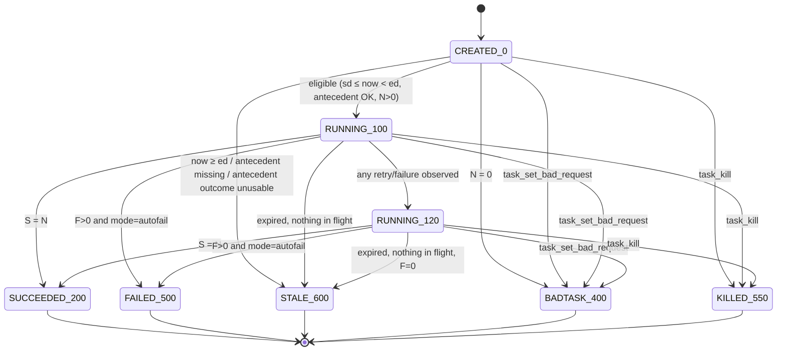

# PRD: SGA Memory — TASK / TASKSLICE State Invariant

| | |
|---|---|
| **Status** | Draft v2 — open questions resolved (§12/§13); ready for implementation |
| **Area** | `azos.sky` — SGA Distributed Memory, Task layer |
| **Source of truth (schema)** | [memory.pg.sql](./memory.pg.sql) — `tbl_task`, `tbl_taskslice` |
| **API surface** | [sgamemory.py](./sgamemory.py) — `task_slice_acquire`, `task_slice_release_ok`, `task_slice_release_failed` |
| **Impl target** | [pgsgamemory.py](./pgsgamemory.py) |

---

## 1. Summary

A **task** is a unit of asynchronous work split into a fixed set of **slices** (fixed at task creation, never added later).
Slices are executed by worker daemons ("workers"), which only ever write **slice** rows.
Task rows are **never** written by workers. Instead, a dedicated periodic daemon — the **Task Invariant Daemon** (TID) —
inspects slices and *stamps* (`UPDATE`s) the `status` of `tbl_task` so that it is eventually consistent with the slice state
(SLA: minutes).

This document extracts the rules, derived from `status` / date columns of **both** tables, that the TID must enforce, and the
concurrency contract (`FOR UPDATE SKIP LOCKED`, no mutexes, no advisory locks, no `tbl_mutex`) that makes the TID and workers safe to run in many instances concurrently.

### Goals

- G1. Define a **deterministic, total** function: *(task row, slice rows, antecedent row, now) → target task status*.
- G2. TID is **idempotent**, **restartable**, and safe to run as N parallel instances.
- G3. No mutex / lock service; coordination only via row locks with `SKIP LOCKED`.
- G4. TID never blocks, and is never blocked by, slice workers.
- G5. Terminal task states are **absorbing**: once stamped, the TID never changes them.

### Non-goals

- Slice execution, scheduling fairness (`nice`) and the worker acquire algorithm beyond the contract in §7.
- Purging/retention of terminal tasks and slices.
- Admin UX for kill / manual stop / slice reset (only their *interaction* with the TID is specified).
- Returning a task result (a task has none by design).
- New columns, indexes or DDL changes. `memory.pg.sql` states DBAs must not alter it; this PRD works within it.

---

## 2. Vocabulary & status codes

### 2.1 Task `status` (`tbl_task.status`)

| Code | Name | Class | Set by |
|---:|---|---|---|
| 0 | CREATED | non-terminal | creator; TID leaves it |
| 100 | RUNNING | non-terminal | TID |
| 120 | RUNNING (partial failures / retries) | non-terminal | TID |
| 200 | SUCCEEDED | **terminal** | TID |
| 400 | FAILED – bad task/args (e.g. unknown app/cmp, no slices) | **terminal** | `task_set_bad_request()` (§7.5); TID only for "no slices" |
| 500 | FAILED – permanent failure | **terminal** | TID |
| 550 | STOPPED – KILL signal | **terminal** | `task_kill()` (§7.5) **only** (never TID) |
| 600 | STALE / outdated | **terminal** | TID |

*Non-terminal* = `{0, 100, 120}`. *Terminal* = `{200, 400, 500, 550, 600}`.

### 2.2 Slice `status` (`tbl_taskslice.status`)

| Code | Name | Class | Meaning |
|---:|---|---|---|
| 0 | CREATED | waiting | never executed (`run_count = 0`, `start_utc IS NULL`) |
| 100 | RUNNING | in-flight | acquired by a worker |
| 120 | RETRYING | waiting | failed, retries remain, waiting for back-off then re-acquire |
| 200 | SUCCEEDED | **terminal** | |
| 500 | FAILED | **terminal** | permanent: retries exhausted |

Slice `200` and `500` are **absorbing** (see §7.4). This property is what makes lock-free evaluation safe.

### 2.3 Derived slice aggregates

For one task, over its slices (`WHERE g_task = :task.gdid`):

| Symbol | Definition |
|---|---|
| `N` | `count(*)` |
| `S` | count with `status = 200` |
| `F` | count with `status = 500` |
| `R` | count with `status = 120` |
| `X` | count with `status = 100` (in-flight) |
| `C` | count with `status = 0` |
| `RC` | `max(run_count)` |

Invariant of aggregates: `N = S + F + R + X + C`.

### 2.4 Time
All timestamps are **UTC `timestamp` (without tz)**. `now` = UTC wall clock of the database (`now() AT TIME ZONE 'UTC'` / DB `TimeZone=UTC`).
Never `timestamptz`. All time comparisons in the TID use the **DB clock**, not the daemon host clock.

---

## 3. Task state machine



Allowed TID transitions (everything else is forbidden and a bug):

| From | To |
|---|---|
| 0 | 100, 400, 600 |
| 100 | 120, 200, 500, 600 |
| 120 | 200, 500, 600 |

`120 → 100` never happens (120 is sticky; see rule R-RUN-5). Terminal → anything never happens.

---

## 4. Invariant rules (the core)

The TID evaluates **one task at a time** against a point-in-time snapshot of its slices, and applies **the first matching rule**
in the order listed. If no rule produces a *different* status than the current one, **no write is performed** (no-op, no `status_utc` bump).

### 4.0 Guard (applies to every rule)

- **R-G1 Absorbing terminals.** Only tasks with `status IN (0, 100, 120)` are candidates. The `UPDATE` carries `AND status = :observed_status`
  (optimistic guard) so a concurrent `task_kill` (550), `task_set_bad_request` (400) or any other writer is never overwritten.
- **R-G2 Stamp fields.** Every write sets `status`, `status_utc = now`, `status_host = <TID host>`, `status_msg` (≤ 64 chars, see §9 catalog).
- **R-G3 No-op suppression.** Don't rewrite identical `status` (avoids bloat and fake `status_utc` churn).

### 4.1 Task in `0 CREATED` (not yet started)

Evaluate in order; first match wins:

| Rule | Condition | Target | `status_msg` |
|---|---|---|---|
| **R-NEW-1** | `N = 0` (task has no slices) | **400** | `no slices` |
| **R-NEW-2** | `now >= ed_utc` | **600** | `expired before start` |
| **R-NEW-3** | `g_antecedent IS NOT NULL` **and** antecedent row **does not exist** | **600** | `antecedent missing` |
| **R-NEW-4** | antecedent exists, is **terminal**, and outcome not acceptable (§4.3) | **600** | `antecedent outcome` |
| **R-NEW-5** | antecedent exists and is **non-terminal** | *stay 0* | — |
| **R-NEW-6** | `now < sd_utc` | *stay 0* | — |
| **R-NEW-7** | otherwise (`sd_utc <= now < ed_utc`, antecedent absent or acceptable, `N > 0`) | **100** | `started` |

Notes:
- `0 → 100` is the **gate** that makes slices acquirable (§7.1). The first slice may therefore wait up to one TID cycle after `sd_utc`.
- The antecedent is consulted **only** while the task is `0`. Once `100`, later changes to / deletion of the antecedent are ignored.
- A task cannot jump `0 → 200/500` directly; it passes through `100` first (slices must have *really* run).
- Self-reference or cycles in `g_antecedent` never become eligible; they resolve by R-NEW-2 at `ed_utc`. No cycle detection required.

### 4.2 Task in `100 RUNNING` / `120 RUNNING (partial)`

Evaluate in order; first match wins:

| Rule | Condition | Target | `status_msg` |
|---|---|---|---|
| **R-RUN-1** | `N = 0` (defensive: slices vanished) | **400** | `no slices` |
| **R-RUN-2 Success** | `S = N` | **200** | `all slices ok` |
| **R-RUN-3 Autofail** | `mode = 0` **and** `F > 0` | **500** | `slice failed` (optionally `slice <seq> failed`) |
| **R-RUN-4 Expiry** | `now >= ed_utc + grace` **and** `X = 0` **and** `F = 0` | **600** | `expired while running` |
| **R-RUN-5 Partial** | current = `100` **and** (`R > 0` **or** `F > 0` **or** `RC > 1`) | **120** | `retries/failures` |
| **R-RUN-6** | otherwise | *no change* | — |

Notes:
- **R-RUN-2 beats everything incl. expiry**: finished work is success even if completed after `ed_utc`.
- **R-RUN-3 is immediate**, regardless of other slices still running / waiting. Remaining slices are simply never acquired again (§7.1 gate on task status);
  slices already in flight finish and write their own row, harmlessly.
  `F` counts only *permanent* slice failures (retries exhausted, §2.2); a slice in `120` is **not** a failure yet.
- **mode = 100 (manual)**: R-RUN-3 never applies. With `F > 0` the task can never reach 200, and per R-RUN-4 (`F = 0` clause) it also doesn't go stale:
  it stays in `120` until an admin stops it (`task_kill`, 550) — consistent with the DDL: *"will stay in running state until admin manually stops it or it succeeds"*.
- **120 is sticky** (R-RUN-5): `RC > 1` stays true forever after the first re-execution, so the indicator is stable & deterministic and never flaps back to 100.
- **`ed_utc` for a running task** gates only *new work* (§7.1). In-flight slices (`X > 0`) are allowed to finish; R-RUN-4 fires only when nothing is in flight.
  `grace` (config, default 60 s) absorbs the race between an acquire that began before `ed_utc` and the TID snapshot.
- Rule order matters: R-RUN-2 → R-RUN-3 → R-RUN-4 → R-RUN-5 (failure outranks staleness; success outranks failure).

### 4.3 Antecedent acceptance (R-NEW-4)

Let `A` = antecedent status:

| `A` | `antecedent_success = true` | `antecedent_success = false` |
|---|---|---|
| `0, 100, 120` (non-terminal) | wait | wait |
| `200` | **accept** | **accept** |
| `400, 500` | reject → 600 | **accept** |
| `550, 600` | reject → 600 | **accept** |
| row missing | reject → 600 | reject → 600 |

(`antecedent_success = false` means *"run after the antecedent completes, whatever the outcome"*; hence 200 is accepted too.
Any terminal non-200 status — the whole `4xx/5xx/6xx` family — counts as a failure that is acceptable when `antecedent_success = false`.)

### 4.4 Truth table (acceptance examples)

| # | Task st. | mode | N | S | F | R | X | C | RC | now vs window | other | → Target |
|--:|---:|---:|--:|--:|--:|--:|--:|--:|--:|---|---|---|
| 1 | 0 | – | 3 | 0 | 0 | 0 | 0 | 3 | 0 | `now < sd` | – | stay 0 |
| 2 | 0 | – | 3 | 0 | 0 | 0 | 0 | 3 | 0 | in window | – | 100 |
| 3 | 0 | – | 3 | 0 | 0 | 0 | 0 | 3 | 0 | `now ≥ ed` | – | 600 |
| 4 | 0 | – | 0 | 0 | 0 | 0 | 0 | 0 | 0 | in window | – | 400 |
| 5 | 0 | – | 3 | 0 | 0 | 0 | 0 | 3 | 0 | in window | antecedent running | stay 0 |
| 6 | 0 | – | 3 | 0 | 0 | 0 | 0 | 3 | 0 | in window | antecedent deleted | 600 |
| 7 | 0 | – | 3 | 0 | 0 | 0 | 0 | 3 | 0 | in window | ant. 500, `success=true` | 600 |
| 8 | 0 | – | 3 | 0 | 0 | 0 | 0 | 3 | 0 | in window | ant. 500, `success=false` | 100 |
| 9 | 100 | 0 | 3 | 1 | 0 | 0 | 1 | 1 | 1 | in window | – | stay 100 |
| 10 | 100 | 0 | 3 | 3 | 0 | 0 | 0 | 0 | 1 | in window | – | 200 |
| 11 | 100 | 0 | 3 | 2 | 0 | 1 | 0 | 0 | 2 | in window | – | 120 |
| 12 | 120 | 0 | 3 | 3 | 0 | 0 | 0 | 0 | 2 | any | – | 200 |
| 13 | 120 | 0 | 3 | 1 | 1 | 0 | 1 | 0 | 3 | in window | – | 500 |
| 14 | 100 | 100 | 3 | 1 | 1 | 0 | 1 | 0 | 3 | in window | – | 120 (stays) |
| 15 | 120 | 100 | 3 | 2 | 1 | 0 | 0 | 0 | 3 | `now ≫ ed` | – | stay 120 (admin must stop) |
| 16 | 100 | any | 3 | 1 | 0 | 0 | 0 | 2 | 1 | `now ≥ ed+grace` | – | 600 |
| 17 | 100 | any | 3 | 1 | 0 | 0 | 1 | 1 | 1 | `now ≥ ed+grace` | slice in flight | stay 100 (wait) |
| 18 | 100 | any | 3 | 3 | 0 | 0 | 0 | 0 | 1 | `now ≫ ed` | – | 200 |
| 19 | 550 | any | – | – | – | – | – | – | – | – | – | untouched |

---

## 5. Slice-level responsibilities the TID depends on

The task invariant is only correct if slices behave as follows. Items marked **(TID)** are also performed by the daemon (a separate, earlier phase of each cycle).

### 5.1 Failure classification (worker side, one atomic `UPDATE`)
`task_slice_release_failed` computes the next slice status **in the same statement** (joins `tbl_task.retry_limit`):

```
run_count <= retry_limit  → status 120 (RETRYING)   -- retries remain
otherwise                 → status 500 (FAILED)     -- exhausted, permanent
```

`run_count` counts executions started (acquire increments it: first execution ⇒ `1`). Total allowed executions = `1 + retry_limit`.
`retry_limit = 0` ⇒ first failure is permanent. Sets `status_utc = now`, `status_host`, `status_msg`, `result` = error.
Consequence: slice `500` is **always final**; the TID never has to compare `run_count` with `retry_limit`.

### 5.2 Back-off (acquire side)
A slice in `120` is acquirable only when `now >= status_utc + backoff(run_count)`.
`backoff(n) = min(cap, base * 2^(n-1))` + jitter. Defaults: `base = 5 s`, `cap = 300 s`, jitter ±20 %. Config-driven (confirmed, D12).
The TID does **not** implement back-off; it only observes the resulting statuses.

### 5.3 Abandoned slice reaper **(TID, phase 1)**
Workers may die while holding a slice (`status = 100`), which would pin a task in running state forever. There is no lease column,
so staleness is derived by joining the owning task: `slice.status = 100 AND now - slice.start_utc > task.slice_timeout_sec`.
Reaper applies **the same atomic transition as §5.1** (120 or 500) with `status_msg = 'abandoned'`, using `FOR UPDATE SKIP LOCKED` on the slice row.
`tbl_task.slice_timeout_sec` is set **at task creation** and is the same for all slices of the task (D10); it must be the maximum legitimate
slice runtime, as slices have no heartbeat/lease. A late `release_ok/failed` from a revived worker must be rejected (see §7.3 guard).

### 5.4 Creation contract
Task row **and all its slices** are inserted in **one transaction**. Slice initial state: `status = 0`, `run_count = 0`, `start_utc = NULL`,
`seq = 0..N-1` contiguous. (`start_host`/`status_host` are `NOT NULL`: use empty string / creator host.)
The task row carries `slice_timeout_sec` (`1..86400`, `NOT NULL`), supplied by the creator.
Hence R-NEW-1 can only legitimately fire on a malformed/foreign-inserted task.

---

## 6. TID algorithm & concurrency

### 6.1 Cycle
Each cycle (period default 15 s; jittered ±20 %), per TID instance:

1. **Phase 1 – slice reaper** (§5.3), bounded batch.
2. **Phase 2 – task stamping**, repeated in bounded batches until a batch returns fewer than `batch_size` rows or cycle time budget is exhausted.

### 6.2 Task batch selection — keyset, not `ORDER BY status_utc`
Rule R-G3 means unchanged waiting tasks keep an old `status_utc`; ordering by it with `LIMIT` would **starve** newer tasks behind permanently
waiting ones. Therefore:

- Page by primary key: `WHERE gdid > :cursor AND status IN (0,100,120) ORDER BY gdid LIMIT :batch`.
- Cursor is TID-instance-local memory; wraps to `0` after an empty page. Start of day / restart ⇒ cursor `0`.
- No new index (PK suffices; DBA constraint).

### 6.3 Locking contract (**no mutex**)

```sql
-- non-normative shape
SELECT gdid FROM tbl_task
 WHERE gdid > :cursor AND status IN (0,100,120)
 ORDER BY gdid LIMIT :batch
   FOR UPDATE SKIP LOCKED;     -- rows locked by another TID are skipped, not waited for
-- evaluate rules in SQL (lateral aggregate over slices) or in Python
-- UPDATE tbl_task SET ... WHERE gdid = :id AND status = :observed;   -- same transaction
```

- **Locks taken by TID:** row lock on the `tbl_task` rows it is evaluating. **Never** on slices, never advisory locks, never `tbl_mutex`.
- **Slice read:** plain `SELECT` aggregate under `READ COMMITTED` (statement-level snapshot). No `FOR SHARE`/`FOR UPDATE` on slices.
- **Locks taken by workers:** row lock on **slice** rows only (`FOR UPDATE SKIP LOCKED` in acquire). Workers read `tbl_task` without locking.
- **Deadlock freedom:** TID and workers never hold row locks in the same table; slice updates don't change `g_task`, so FK checks
  take no conflicting lock on the parent task row (`FOR NO KEY UPDATE` by TID vs `KEY SHARE` of FK are compatible).
- **Multiple TIDs:** safe. A locked task is skipped and is picked up by the next cycle. Two TIDs can never stamp the same task concurrently.
- **Short transactions:** commit per batch; batch ≤ 200 tasks (config).
- **Crash safety:** TID holds no state beyond the cursor; killed mid-batch ⇒ transaction rolls back, next cycle redoes it.
- `statement_timeout` / `lock_timeout` should be set on TID sessions as defense in depth (default 10 s).

### 6.4 Why lock-free slice reading is sound (monotonic-fact argument)
Every transition the TID *acts on* is based on a fact that can never be undone by workers after the snapshot:

| Decision | Fact used | Why it cannot be invalidated later |
|---|---|---|
| 200 | `S = N` | slice 200 is absorbing |
| 500 | `F > 0` | slice 500 is absorbing |
| 120 | `R > 0` / `F > 0` / `RC > 1` | `RC` only grows; 120/500 are sticky facts at the task level |
| 100 → … | task status | guarded by `AND status = :observed` |
| 600 expiry | `X = 0` past `ed+grace` | acquire is gated by `now < ed` (§7.1); `grace` covers in-flight acquire commit |

Decisions on *transient* facts (`C`, `X`, `R` counts alone) only produce **no-ops or waits**, never terminal stamps (except R-RUN-4, protected by grace).

---

## 7. Contracts with other components

### 7.1 `task_slice_acquire(app, cmp)` must
- Only pick slices whose task has `status IN (100, 120)` **and** `now < ed_utc` (i.e. **0 is not acquirable**; the TID gates start).
- Pick slices with `status = 0`, or `status = 120 AND now >= status_utc + backoff(run_count)`.
- Match `task.app = :app AND task.cmp = :cmp`; order by `task.nice` (then `task.sd_utc`, `slice.seq`).
- Lock with `FOR UPDATE OF slice SKIP LOCKED`; set `status = 100, run_count = run_count + 1, start_utc = now, start_host, status_utc = now, status_host`.

### 7.2 Task terminal ⇒ slices frozen
Once a task is terminal (incl. 400/550) acquire never picks its slices (7.1). The TID does **not** cascade statuses to leftover slices (they remain `0/120/100`
as historical evidence). Slice reaper (§5.3) **does** still process abandoned in-flight slices of terminal tasks (cheap, keeps data coherent).

### 7.3 Release guard
`release_ok/failed` must `UPDATE ... WHERE gdid = :g_slice AND status = 100 AND run_count = :handle.run_count`
(handle needs the `run_count` it acquired with — **change to `TaskSliceHandle`**, see §10) so that a worker whose slice was reaped & re-acquired
cannot overwrite the newer attempt. 0 rows updated ⇒ log and drop.

### 7.4 Absorbing slice states
Nothing in the memory layer moves a slice out of `200`/`500`. A future admin "reset slice" feature would necessarily also reset its task, and
terminal task states stay absorbing for the TID (R-G1); such a feature must create a **new** task. (Out of scope; noted to protect the invariant.)

### 7.5 Task-level terminal calls: `task_set_bad_request` (400) and `task_kill` (550)
Both are SGA API methods taking a `TaskHandle` (`g_task`); neither is ever issued by the TID.

- Each does `UPDATE tbl_task SET status = <400|550>, status_utc = now, status_host, status_msg, status_data ... WHERE gdid = :g_task AND status IN (0,100,120)`.
  0 rows updated (task unknown or already terminal) ⇒ the call is a no-op and returns `False`; it never overwrites a terminal state.
- The TID's `AND status = :observed` guard resolves races with these calls (whoever commits first wins; the other updates 0 rows).
- The "terminal exception" of `task_set_bad_request` (error details) is stored in `tbl_task.status_data` (`jsonb`, ≤ 256 KB by `chk_task_sdata_maxsize`).
  `status_msg` (≤ 64 chars, truncated) only carries a short human-readable summary and is **not** used for error details.
  `status_data` describes the task itself; it is not a task result (a task has none) — slice results stay in `tbl_taskslice.result`.
- The TID does not write `status_data` (it stamps only `status`, `status_utc`, `status_host`, `status_msg`); the cause of a TID-stamped failure is in the slices' `result`.
- Slices are **not** touched (§7.2): unstarted slices remain `0`; in-flight slices finish and write their own rows, which no longer affect the task.
- Typical callers: a worker that finds that slice args / `app` / `cmp` can never work calls `task_set_bad_request` (400); an admin or system calls `task_kill` (550).

---

## 8. Configuration

| Key | Default | Meaning |
|---|---|---|
| `tid.period_sec` | 15 | cycle period (±20 % jitter) |
| `tid.batch_size` | 200 | tasks per transaction |
| `tid.cycle_budget_sec` | 30 | max time per cycle |
| `tid.expiry_grace_sec` | 60 | `grace` of R-RUN-4 |
| `slice.backoff_base_sec` / `slice.backoff_cap_sec` | 5 / 300 | back-off (§5.2) |
| `tid.statement_timeout_ms` | 10000 | session timeouts |

---

## 9. Observability

- `status_msg` catalog (≤ 64 chars, `TASK_STATUS_MSG_MAX_LEN`): `started`, `retries/failures`, `all slices ok`, `slice failed`,
  `expired before start`, `expired while running`, `antecedent missing`, `antecedent outcome`, `no slices`, `abandoned` (slice). `400`/`550` messages are supplied by the caller of `task_set_bad_request` / `task_kill`.
- Log every stamp (structured, see APM logging) at INFO with `ctag` as correlation, old→new status, rule id (`R-RUN-3`…), `N/S/F/R/X/C`.
- Counters per cycle: tasks examined / stamped per target status / skipped-locked / cycle duration / slices reaped.
- WARN if a cycle exceeds its budget or `skipped-locked` ratio is persistently high.

---

## 10. Required follow-ups on existing code (found during analysis)

1. ✅ (done in API stubs) `TaskSliceHandle` ([sgamemory.py](./sgamemory.py)) gets `run_count` for the release guard (§7.3); its `timeout` is sourced from `tbl_task.slice_timeout_sec`.
2. ✅ (done in API stubs) New `TaskHandle`, `task_set_bad_request`, `task_kill` (§7.5); acquire/release docstrings updated to the contracts of §5.1, §7.1, §7.3.
3. ✅ (done in DDL) `tbl_task.slice_timeout_sec` with check constraint; antecedent comment contradiction fixed; slice `120`/`500`/`run_count` semantics documented.
4. ⏳ Implementation in [pgsgamemory.py](./pgsgamemory.py): acquire gating (§7.1), atomic release classification (§5.1), reaper (§5.3), task batch (§6), the two terminal calls (§7.5).
5. ⏳ DBs created from the previous script version need: `ALTER TABLE tbl_task ADD COLUMN slice_timeout_sec int NOT NULL DEFAULT 900; ALTER TABLE tbl_task ADD CONSTRAINT chk_task_slice_timeout CHECK (slice_timeout_sec BETWEEN 1 AND 86400);`
   (drop the `DEFAULT` afterwards if creators must always supply it).

---

## 11. Test plan

1. **Pure-function tests** of the rule evaluator: every row of §4.4 + each rule's boundary (`now == sd`, `now == ed`, `now == ed+grace`).
2. **Property tests**: (a) idempotence — applying evaluator twice yields no second change; (b) transitions only from the §3 allowed table;
   (c) terminal states never change; (d) status 120 never returns to 100.
3. **PG integration** (real Postgres, see [memory.pg.sql](./memory.pg.sql)): scenarios with slices driven by simulated workers.
4. **Concurrency**: 2–4 TID instances + N workers on the same data set; assert (a) no task stamped twice per change, (b) no waits on locks
   (`lock_timeout` tiny), (c) final statuses equal the single-TID result, (d) concurrent admin KILL never overwritten.
5. **Starvation**: > `batch_size` permanently-waiting tasks do not prevent processing of later tasks (§6.2).
6. **Reaper**: killed worker ⇒ slice reaped → retried → task reaches expected terminal status; stale release rejected (§7.3).
7. **Antecedent**: matrix of §4.3 incl. deleted antecedent, cycle, self-reference.
8. **Task-level calls** (§7.5): `task_set_bad_request` / `task_kill` on each non-terminal status → 400/550; on terminal or unknown task → `False`, no change;
   race with the TID stamp (exactly one wins); `status_msg` truncation to 64 chars; error details land in `status_data` (and are subject to the 256 KB check); slices untouched.
9. **Slice timeout** (§5.3): per-task `slice_timeout_sec` honored by the reaper (two tasks with different values); check constraint rejects `0` and `86400+1`.

---

## 12. Decisions

| ID | Decision | Rationale / alternative |
|---|---|---|
| D1 | Slice `500` is **final**; 120-vs-500 decided atomically at release/reap. | Simplest, TID needs no `retry_limit` join. Alt: worker writes 500 and TID requeues → needs a 500-with-retries "transient" state and 2 writers per slice. |
| D2 | Autofail counts only **permanent** slice failures. | `retry_limit` would otherwise be meaningless in mode 0. |
| D3 | TID gates `0 → 100`; acquire requires task `100/120`. | Gives `sd_utc`/antecedent/stale logic one owner. Cost: start latency ≤ one cycle. |
| D4 | Unusable antecedent ⇒ **600 STALE** (not 500). | The task itself never ran; matches "deleted antecedent ⇒ stale". |
| D5 | Running task past `ed_utc` ⇒ 600 only if nothing in flight and no permanent failures; else wait / manual. | Keeps manual-mode contract; avoids killing live work. |
| D6 | Keyset paging by `gdid`, no new index. | Avoids starvation; honors the "no indexes" rule. |
| D7 | Zero slices ⇒ **400** by TID. | An empty task would otherwise vacuously "succeed". |
| D8 | `ed_utc` = "do not start after"; never a deadline for in-flight work (was Q1). | Task not started by `ed_utc` becomes `600`. |
| D9 | No cascade of task terminal status to slices; unstarted slices stay `0` (was Q3). | They never ran; the history stays truthful. |
| D10 | `slice_timeout_sec` is a column of `tbl_task`, set at creation, identical for all slices (was Q4). | Reaper joins task; no global config. |
| D11 | Any terminal non-200 antecedent (`4xx/5xx/6xx`) satisfies `antecedent_success = false` (was Q2). | §4.3. |
| D12 | Back-off defaults confirmed: `min(cap, base*2^(n-1))` + jitter (was Q5). | §5.2. |
| D13 | `400` and `550` are set only by the task-level SGA calls `task_set_bad_request` / `task_kill`; the TID never writes `550` and writes `400` only for "no slices" (was Q6). | §7.5. |
| D14 | Terminal exception details of a task (`task_set_bad_request`/`task_kill`) are stored in `tbl_task.status_data` (`jsonb`); `status_msg` is only a short summary (≤ 64 chars). | Error details do not fit 64 chars; `status_data` exists in the DDL for exactly this. |
| D15 | Authorization of `task_kill` / `task_set_bad_request` callers (not modelled in the memory layer) will be protected by Azos permissions when we add them |


